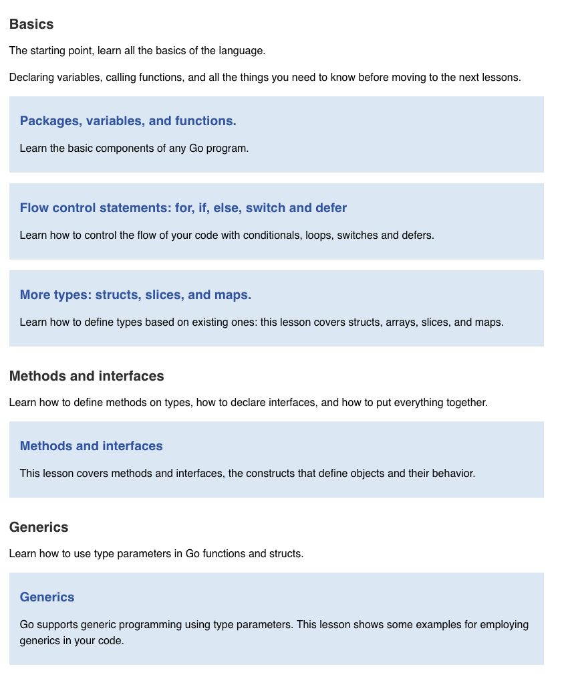

# Tour of Go


## Playground
The Go Playground
This tour is built atop the Go Playground, a web service that runs on golang.org's servers.

The service receives a Go program, compiles, links, and runs the program inside a sandbox, then returns the output.

There are limitations to the programs that can be run in the playground:

In the playground the time begins at 2009-11-10 23:00:00 UTC (determining the significance of this date is an exercise for the reader). This makes it easier to cache programs by giving them deterministic output.
There are also limits on execution time and on CPU and memory usage, and the program cannot access external network hosts.

## Plan



## Basics 

### Packages, variables and functions   

(For more about why types look the way they do, see the article on [Go's declaration syntax](https://go.dev/blog/gos-declaration-syntax).)

shorthand:

1. vars and arguments types can be indicated last if all share same type

    `var c, python, java bool`  
    `x int, y int -->  x, y int`

    ```
    func add(x, y int) int {
        return x + y
    }
    ```  
2. type can be omitted if value is used

    ```
    var i, j int = 1, 2

    func main() {
        var c, python, java = true, false, "no!"
        fmt.Println(i, j, c, python, java)
    }
    ```

3. := short assignment in place of var dec  
    **ONLY available in functions**  

    ```
     k := 3
	c, python, java := true, false, "no!"
    ```

4. Go's basic types are

    ```    
    bool

    string

    int  int8  int16  int32  int64
    uint uint8 uint16 uint32 uint64 uintptr

    byte // alias for uint8

    rune // alias for int32
        // represents a Unicode code point

    float32 float64

    complex64 complex128
    ```  

5. imports and var dec can be factored   

    ```
    import (
	"fmt"
	"math/cmplx"
    )

    var (
        ToBe   bool       = false
        MaxInt uint64     = 1<<64 - 1
        z      complex128 = cmplx.Sqrt(-5 + 12i)
    )
    ```  

6. multiple return values  
    **MUST account for all returned values from a function**  
    to ignore one you use the blank identifier

    ```
    result, _ := strconv.Atoi("42")   // explicitly discard the error
    ```  

7.  Uninitialized variables: not untyped, they get zero values

Every Go variable has a type from the moment it’s declared, and var x int is immediately usable. It holds the zero value for its type:

numbers: 0
bool: false
string: "" (empty string)
pointers, slices, maps, channels, functions, interfaces: nil

### Flow control statements  

1. `For`  
    three components separated by semicolons:

    the init statement: executed before the first iteration
    the condition expression: evaluated before every iteration
    the post statement: executed at the end of every iteration

    ```
    for i := 0; i < 10; i++ {
		sum += i
		fmt.Println(i, sum)
	}
    ```

    NOTE: no parentheses surrounding the three components of the for statement and the braces { } are always required.

    init and post statements are optional

    ```
    for ; sum < 1000; {
		sum += sum
	}
    ```

2.  `For` is Go's "while"
At that point you can drop the semicolons: C's while is spelled for in Go  
    ```
    for sum < 1000 {
		sum += sum
	}
    ```

3. `If`  
    if statements are like its for loops, expression need not be surrounded by parentheses ( ) but the braces { } are required

    ```
    if x < 0 {
		return sqrt(-x) + "i"
	}
	return fmt.Sprint(math.Sqrt(x))
    ```   

4.  If with a short statement  
    Like `for`, the `if` statement can start with a short statement to execute before the condition.

    Variables declared by the statement are only in scope until the end of the if.  (includes the else)

    ```
    if v := math.Pow(x, n); v < lim {
		return v
	}  else  {
        fmt.Printf("%g >= %g\n", v, lim)
    }
	return lim
    ```

Exercise


```
package main

import (
	"fmt"
)


func Sqrt(x float64) float64 {
	z := float64(2)
	for i := 0; i < 10; i++ {
		z -= (z*z - x) / (2*z)
		fmt.Println(z)
	}
	return z
}

func main() {
	fmt.Println(Sqrt(4))
}
```   

> refactor to see how close we can get to the math std lib

```
package main

import (
	"fmt"
	"math"
)

func Sqrt(x float64) float64 {
	z := 1.0
	for {
		next := z - (z*z-x)/(2*z)
		if math.Abs(next - z) < 1e-12 {
			return next
		}
		z = next
	}
}

func main() {
	num := float64(3)
	fmt.Println(Sqrt(num))
	fmt.Println(math.Sqrt(num))
}
```

2. `Switch`  
* break is inferred rather than in other languages. once a condition is met the logic stops and returns.  
* switch cases do not need to be constants and values are not restricted to integers  
* Switch cases evaluate cases from top to bottom, stopping when a case succeeds

```  
// switch with a condition
switch i {
case 0:
case f():
}  

// without a condition (switch true) clean way to write long if-then-else chains
switch {
	case t.Hour() < 12:
		fmt.Println("Good morning!")
	case t.Hour() < 17:
		fmt.Println("Good afternoon.")
	default:
		fmt.Println("Good evening.")
	}
```   

3.  `Defer`  
* defers the execution of a function until the surrounding function returns  
* more detail in [this blog](https://go.dev/blog/defer-panic-and-recover)

    ```  
    func main() {
        fmt.Println("counting")

        for i := 0; i < 10; i++ {
            defer fmt.Println(i)
        }

        fmt.Println("done")
    }

    // results are LIFO, notice in the print of each count in reverse  

    counting
    done
    9
    8
    7
    6
    5
    4
    3
    2
    1
    0 
    ``` 

### More types: structs, slices and maps  

1.  `Pointers`  
* Holds a memory address of a value  
* `&` operator generates a pointer to its operand
* `*` operator denotes a reference to the underlying value  
* This is known as "dereferencing" or "indirecting"

> Unlike C, Go has no pointer arithmetic

```go
i := 42
p := &i

fmt.Println(*p) // read i through the pointer p
*p = 21         // set i through the pointer p
```

2. `Struct`  
* Collection of fields  
* Struct fields are accessed using a dot
* Struct fields can be accessed through a struct pointer  


```go 
type Vertex struct {
	X int
	Y int
}

func main() {
	fmt.Println(Vertex{1, 2})
}

// or  
func main() {
	v := Vertex{1, 2}
	v.X = 4
	fmt.Println(v.X)
}  

// or 
func main() {
	v := Vertex{1, 2}
	p := &v
	p.X = 1e9
	fmt.Println(v)
}
```  

> ***BONUS NOTE***:  why does 1e9 fit in int?  

>The answer is that 1e9 in Go source isn’t a float. It’s an untyped constant, and Go converts untyped constants to whatever type the context needs, as long as the value fits and is representable.

> What’s happening

> The literal 1e9 is written in floating-point notation, so it’s an untyped floating-point constant. It has no concrete type like float64 yet.
>When you assign it to p.X, the compiler needs an int. Since 1e9 has no fractional part (it’s exactly 1,000,000,000), it’s representable as an int, so the conversion is allowed and happens at compile time.
>The value fits easily. On your 64-bit machine int goes up to about 9.2 quintillion, and even a 32-bit int (max about 2.1 billion) could hold 1 billion.

:bangbang:  **Why pointer to a struct (not a copy of)?** 
The short answer: you want a pointer when you need shared, mutable access to one struct instead of working with copies. In Go, assigning or passing a struct by value copies the whole thing.

```go
v := Vertex{1, 2}
w := v      // w is a separate copy
w.X = 99
fmt.Println(v.X) // still 1

p := &v
p.X = 99
fmt.Println(v.X) // 99, p points at v itself
```

Why you’d reach for a pointer

Mutation across function calls. A function that receives a struct by value modifies only its own copy. To change the caller’s struct, take a pointer:
```go

   v1 := Vertex{1,2}
   func scale(v *Vertex, f int) {
       v.X *= f
       v.Y *= f
   }
   scale(&v1, 10) // v1 is changed
```
Avoiding copies of large structs. Passing a struct with many fields or big embedded data copies all of it each call. A pointer is one machine word (8 bytes on your Mac) regardless of struct size. For a tiny Vertex it doesn’t matter, but real structs like a config or a request context add up.
Shared state. If two parts of the program must see the same object (a connection pool, a cache, a server holding its config), they hold pointers to one instance rather than separate copies.
Optional or absent values. A pointer can be nil, a value can’t. *Vertex can mean “there might not be one,” and nil expresses that. You’ll see this in JSON APIs, where a *string field distinguishes “missing” from "".
Pointer receivers on methods. This is the big one for the next lesson. Methods that modify their receiver, or whose type holds state like a mutex, must use a pointer receiver (func (v *Vertex) Scale(f int)).

About the p = &Vertex{1, 2} line specifically

It’s a shorthand: create a Vertex literal and take its address in one step, with no named variable needed. You’ll see this constantly as a constructor idiom:

```go
func NewServer(addr string) *Server {
    return &Server{addr: addr}
}
```

Unlike C, returning the address of something you created locally is safe in Go. The compiler notices the value escapes and keeps it alive, so you don’t worry about dangling pointers.

:bulb: **for better explanation of Structs and using pointers** see /Users/lynn_piscoran/go-training/pointers/pointers.go


In `scaleByValue`, Go copies b into the parameter v. The function multiplies the copy, then returns, and the copy is discarded. b never changes, so the function did work that nobody can see. That’s why it’s useless as written.

In `scaleByPointer`, v holds the address of a. v.X *= f follows that address and changes the original, so the caller sees the result.  

***For your REST API work***

You’ll use pointers in two main places: handler structs that hold dependencies (type API struct { db *sql.DB } with methods on *API), and JSON request/response structs where optional fields are pointers.

A rule of thumb for now: small, immutable-feeling data (a Vertex, a point, a time range) is fine by value. Anything you need to modify in place, share, or leave optional gets a pointer. You don’t need to settle this yet, since the Methods lesson makes the value-vs-pointer decision concrete.

> ***BONUS NOTE***  
> *= is a compound assignment operator, and it’s pure shorthand. This:

```go
v.X *= f
```

> means exactly the same as:

```go
v.X = v.X * f
```

> It reads “multiply v.X by f and store the result back in v.X
>The others work the same way: +=, -=, *=, /=, %=.


3.  `Arrays`  
* type [n]T is an array of n values of type T  
* an array's length is part of its type, so arrays cannot be resized. This seems limiting, but don't worry; Go provides a convenient way of working with arrays
* Slices are like references to arrays. slice does not store any data, it just describes a section of an underlying array
* Changing the elements of a slice modifies the corresponding elements of its underlying array.

```go 
package main

import "fmt"

func main() {
	var a [2]string
	a[0] = "Hello"
	a[1] = "World"
	fmt.Println(a[0], a[1])
	fmt.Println(a)

	primes := [6]int{2, 3, 5, 7, 11, 13}
	fmt.Println(primes)
}

===============
Hello World
[Hello World]
[2 3 5 7 11 13]
```

4.  `Slices` 
* An array has a fixed size. A slice, on the other hand, is a dynamically-sized, flexible view into the elements of an array. In practice, slices are much more common than arrays.  
* A slice is formed by specifying two indices, a low and high bound, separated by a colon:

    * `a[low : high]`
    * `a[1:4] //creates a slice which includes elements 1 through 3 of a`  

    ```go 
    func main() {
	primes := [6]int{2, 3, 5, 7, 11, 13}

	var s []int = primes[1:4]
	fmt.Println(s)
    }

    ===========
    [3 5 7]
    ```   

    ```go 
    func main() {
	names := [4]string{
		"John",
		"Paul",
		"George",
		"Ringo",
	}
	fmt.Println(names)

	a := names[0:2]
	b := names[1:3]
	fmt.Println(a, b)

	b[0] = "XXX"
	fmt.Println(a, b)
	fmt.Println(names)
    }

    =========================
    [John Paul George Ringo]
    [John Paul] [Paul George]
    [John XXX] [XXX George]
    [John XXX George Ringo]
    ```
* Slice defaults 
    `var a [10]int`
    these slice expressions are equivalent:

    ```go 
    a[0:10]
    a[:10]
    a[0:]
    a[:]
    ```
* Slice length and capacity
    * The length of a slice is the number of elements it contains.

    * The capacity of a slice is the number of elements in the underlying array, counting from the first element in the slice.

* Slices of slices (tic tac toe)
    ```go
    // Create a tic-tac-toe board.
	board := [][]string{
		[]string{"_", "_", "_"},
		[]string{"_", "_", "_"},
		[]string{"_", "_", "_"},
	}

	// The players take turns.
	board[0][0] = "X"
	board[2][2] = "O"
	board[1][2] = "X"
	board[1][0] = "O"
	board[0][2] = "X"

	for i := 0; i < len(board); i++ {
		fmt.Printf("%s\n", strings.Join(board[i], " "))
	}

    X _ X
    O _ X
    _ _ O
    ```

* Appending to a slice
* Range - index, value (for loop)
    ```go 
    var pow = []int{1, 2, 4, 8, 16, 32, 64, 128}

    func main() {
        for i, v := range pow {
            fmt.Printf("2**%d = %d\n", i, v)
        }
    }

    ====================

    2**0 = 1
    2**1 = 2
    2**2 = 4
    2**3 = 8
    2**4 = 16
    2**5 = 32
    2**6 = 64
    2**7 = 128
    ```  
    * You can skip the index or value by assigning to _.

        ```
        for i, _ := range pow
        for _, value := range pow
        ```
    * If you only want the index, you can omit the second variable.

        `for i := range pow`


5. `Maps` 
* A map maps keys to values.
* The zero value of a map is nil. A nil map has no keys, nor can keys be added.
* The make function returns a map of the given type, initialized and ready for use
    
    ```go 
    type Vertex struct {
	Lat, Long float64
    }

    var m map[string]Vertex

    func main() {
        m = make(map[string]Vertex)
        m["Bell Labs"] = Vertex{
            40.68433, -74.39967,
        }
        fmt.Println(m["Bell Labs"])
    }
    ```  

* If the top-level type is just a type name, you can omit it from the elements of the literal.  
    ```go 
    type Vertex struct {
	Lat, Long float64
    }

    var m = map[string]Vertex{
        "Bell Labs": {40.68433, -74.39967},
        "Google":    {37.42202, -122.08408},
    }
    ```  

* Lookup values by key, check if ok (== try/catch)  
    ```go 
    func main() {
	m := make(map[string]int)

	m["Answer"] = 42
	fmt.Println("The value:", m["Answer"])

	m["Answer"] = 48
	fmt.Println("The value:", m["Answer"])

	delete(m, "Answer")
	fmt.Println("The value:", m["Answer"])

	v, ok := m["Answer"]
	fmt.Println("The value:", v, "Present?", ok)
    }
    ```

----
### Methods  

1. A method is a function with a special receiver argument.

    The receiver appears in its own argument list between the func keyword and the method name.

    In this example, the Abs method has a receiver of type Vertex named v

    ```go 
    package main

    import (
        "fmt"
        "math"
    )

    type Vertex struct {
        X, Y float64
    }

    func (v Vertex) Abs() float64 {
        return math.Sqrt(v.X*v.X + v.Y*v.Y)
    }

    func main() {
        v := Vertex{3, 4}
        fmt.Println(v.Abs())
    }
    ```

    **Compare to**  
    * Remember: a method is just a function with a receiver argument.  Here's Abs written as a regular function with no change in functionality  

    ```go 
    type Vertex struct {
        X, Y float64
    }

    func Abs(v Vertex) float64 {
        return math.Sqrt(v.X*v.X + v.Y*v.Y)
    }

    func main() {
        v := Vertex{3, 4}
        fmt.Println(Abs(v))
    }
    ```  

    * Non struct Types can have methods  
    ```go 
    type MyFloat float64

    func (f MyFloat) Abs() float64 {
        if f < 0 {
            return float64(-f)
        }
        return float64(f)
    }

    func main() {
        f := MyFloat(-math.Sqrt2)
        fmt.Println(f.Abs())
    }
    ``` 

2.  Pointer Receivers 
* Methods with pointer receivers can modify the value to which the receiver points (as Scale does here). Since methods often need to modify their receiver, pointer receivers are more common than value receivers.
* if you want to have your method update the pointer values you must have the receiver take in a pointer rather than a copy.  
* Here when Abs which does not take in a pointer executes it on the value provided.  if you scale only the copy, Abs will act on the initial set values.  
```go 
package main

import (
	"fmt"
	"math"
)

type Vertex struct {
	X, Y float64
}

func (v Vertex) Abs() float64 {
    fmt.Println("In Abs", v)
	return math.Sqrt(v.X*v.X + v.Y*v.Y)
}

func (v *Vertex) Scale(f float64) {
    fmt.Println(v)
	v.X = v.X * f
	v.Y = v.Y * f
	fmt.Println(v)
}

func main() {
	v := Vertex{3, 4}
	v.Scale(10)
	fmt.Println(v.Abs())
}

===========
&{3 4}
&{30 40}
In Abs {30 40}
50
```

3. Methods and pointer indirection
    Comparing the previous two programs, you might notice that functions with a pointer argument must take a pointer:

    ```
    var v Vertex
    ScaleFunc(v, 5)  // Compile error!
    ScaleFunc(&v, 5) // OK
    ```

    while methods with pointer receivers take either a value or a pointer as the receiver when they are called:

    ```
    var v Vertex
    v.Scale(5)  // OK
    p := &v
    p.Scale(10) // OK
    ```

    For the statement v.Scale(5), even though v is a value and not a pointer, the method with the pointer receiver is called automatically. That is, as a convenience, Go interprets the statement v.Scale(5) as (&v).Scale(5) since the Scale method has a pointer receiver.

    ```go 
    type Vertex struct {
	X, Y float64
    }

    func (v *Vertex) Scale(f float64) {
        v.X = v.X * f
        v.Y = v.Y * f
    }

    func ScaleFunc(v *Vertex, f float64) {
        v.X = v.X * f
        v.Y = v.Y * f
    }

    func main() {
        v := Vertex{3, 4}
        v.Scale(2)
        ScaleFunc(&v, 10)

        p := &Vertex{4, 3}
        p.Scale(3)
        ScaleFunc(p, 8)

        fmt.Println(v, p)
    }

    ===========
    {60 80} &{96 72}
    ```

* The equivalent thing happens in the reverse direction.

    Functions that take a value argument must take a value of that specific type:

    ```
    var v Vertex
    fmt.Println(AbsFunc(v))  // OK
    fmt.Println(AbsFunc(&v)) // Compile error!
    ```

    while methods with value receivers take either a value or a pointer as the receiver when they are called:

    ```
    var v Vertex
    fmt.Println(v.Abs()) // OK
    p := &v
    fmt.Println(p.Abs()) // OK
    ```
    In this case, the method call p.Abs() is interpreted as (*p).Abs() 

    ```go 
    package main

    import (
        "fmt"
        "math"
    )

    type Vertex struct {
        X, Y float64
    }

    func (v Vertex) Abs() float64 {
        return math.Sqrt(v.X*v.X + v.Y*v.Y)
    }

    func AbsFunc(v Vertex) float64 {
        return math.Sqrt(v.X*v.X + v.Y*v.Y)
    }

    func main() {
        v := Vertex{3, 4}
        fmt.Println(v.Abs())
        fmt.Println(AbsFunc(v))

        p := &Vertex{4, 3}
        fmt.Println(p.Abs())
        fmt.Println(AbsFunc(*p))
    }

    ============
    5
    5
    5
    5
    ```  
    * There are two reasons to use a pointer receiver.
        * The first is so that the method can modify the value that its receiver points to.

        * The second is to avoid copying the value on each method call. This can be more efficient if the receiver is a large struct, for example.

            In this example, both Scale and Abs are methods with receiver type *Vertex, even though the Abs method needn't modify its receiver.  

            In general, all methods on a given type should have either value or pointer receivers, but not a mixture of both

5. `Interfaces`  